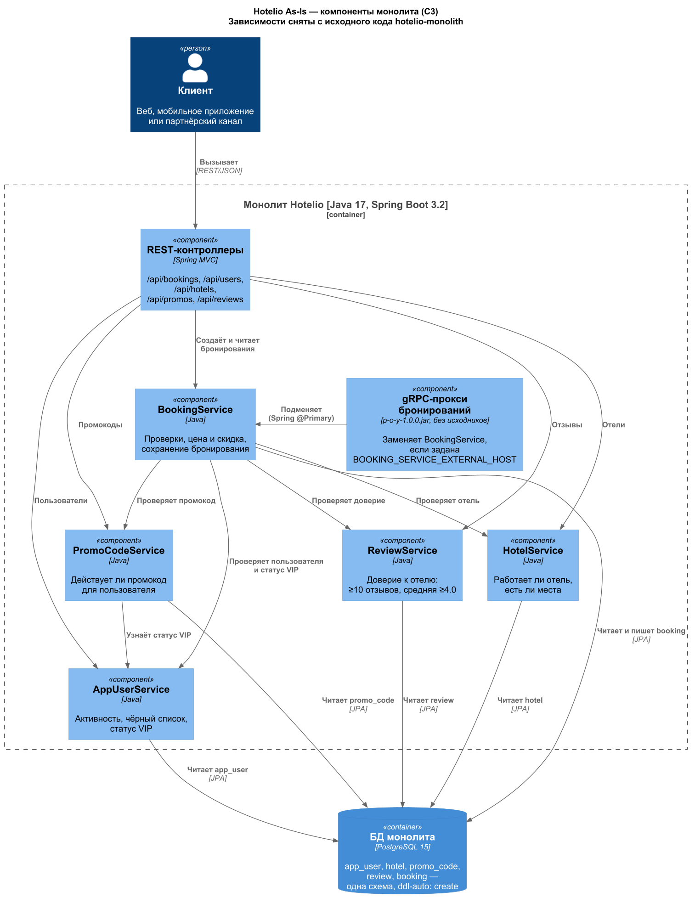
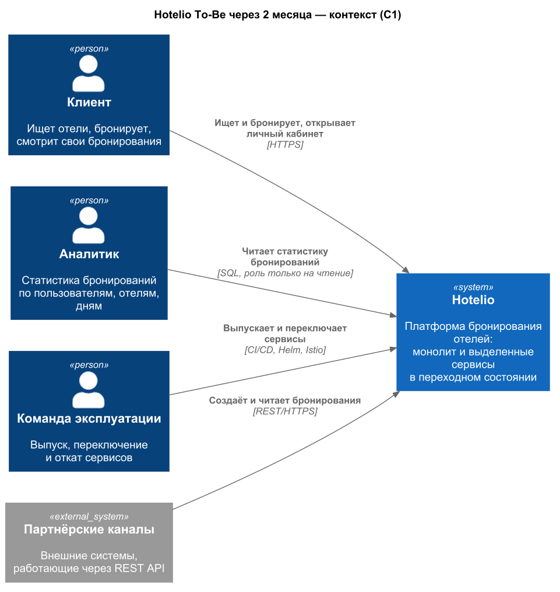
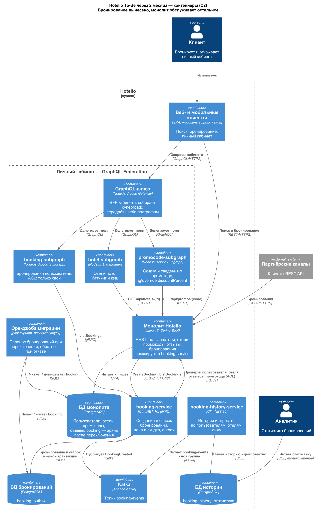
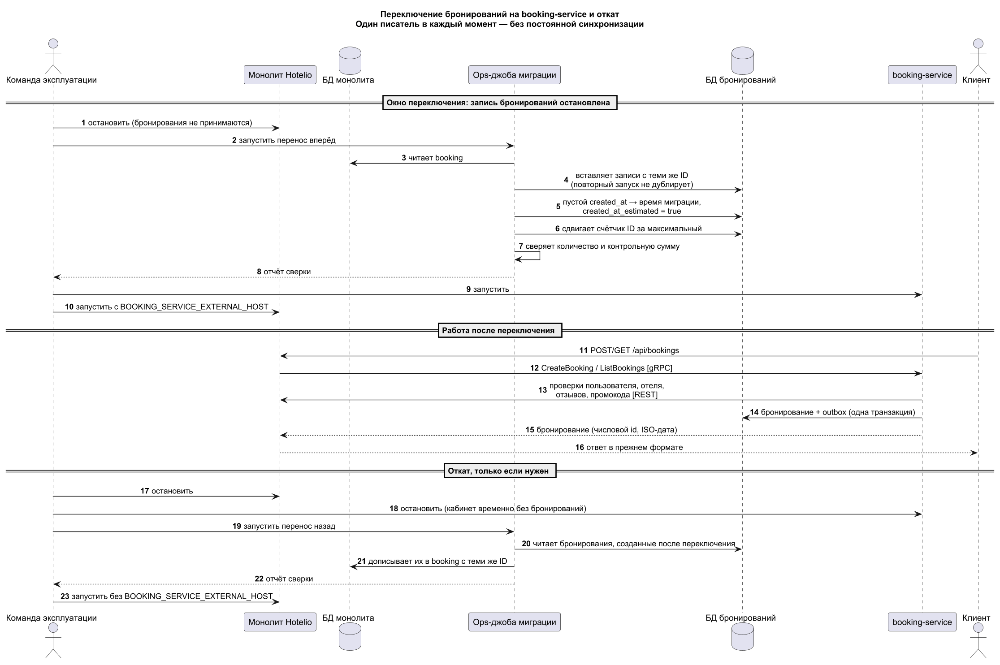
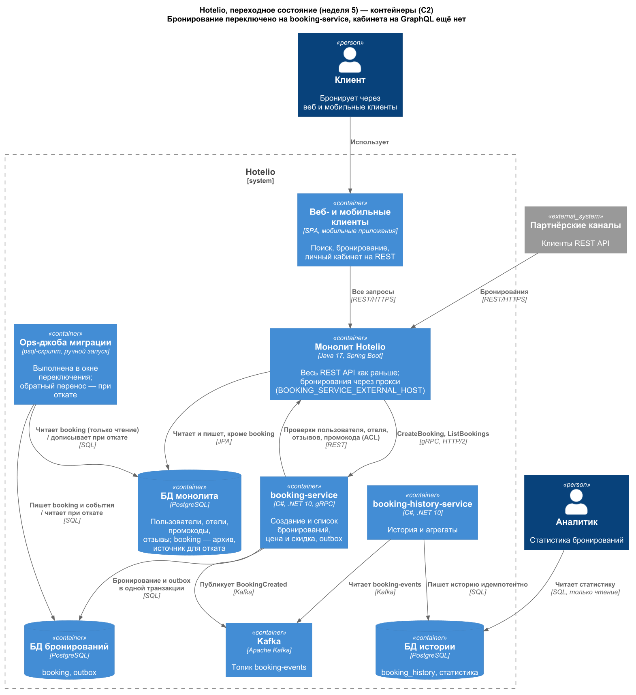

### **Название задачи:** ADR-001. Поэтапный переход Hotelio на микросервисы: первым выносим бронирование
### **Автор:** Святослав Рожков
### **Дата:** 18.10.2026

Статус: принято. Горизонт решения — промежуточное состояние через два месяца; цель через год описана в конце раздела «Решение».

### **Контекст и проблемы**

Hotelio — платформа бронирования отелей: около 1 млн пользователей, основной трафик — поиск и бронирование. Всё работает в одном Java-приложении (Spring Boot) с одной PostgreSQL. Команда: два Java-разработчика, архитектор, который пишет код, фронтенд-разработчик, DevOps, тестировщик и продакт. В инфраструктуре уже есть PostgreSQL, Kafka и Docker.

Цель через год — микросервисы, service mesh, масштабируемая Kafka, метрики и трассировка каждого сервиса, GraphQL для фронтенда. Через два месяца: несколько сервисов мигрированы, старые модули не дорабатываются, новые функции пишутся только в мигрированных сервисах, начато разделение баз.

Перед проектированием мы подняли монолит и прогнали регрессионные тесты курса — все 29 проверок прошли ([test-log.txt](test-log.txt)). Схема As-Is ниже снята с кода, а не со схемы курса: в коде есть зависимость промокодов от пользователей, которой нет на исходной схеме.

[Исходник PlantUML](diagrams/as-is-components.puml)

As-Is показан сразу на уровне компонентов (C3): контейнер в системе один — монолит со своей PostgreSQL. Переходное состояние и горизонт двух месяцев показаны ниже на уровне контейнеров (C2).

**Проблемы из постановки**

| № | Проблема | Что это значит для нас |
| :-: | :- | :- |
| П1 | Любое изменение требует понимания всей кодовой базы | `BookingService` напрямую вызывает четыре модуля, `PromoCodeService` — модуль пользователей |
| П2 | Нельзя масштабировать только бронирование | Пик бронирований масштабирует весь монолит вместе с отзывами и справочниками |
| П3 | Команды не работают независимо, сложно внедрить CI/CD | Один артефакт и один релиз на все модули |
| П4 | Универсальный REST, нет BFF | Личному кабинету нужно несколько последовательных вызовов разных доменов |
| П5 | Высокий риск ошибок при новых функциях | Тестирование требует знания всех зависимостей |

**Проблемы, найденные в коде и на стенде**

| № | Проблема | Где видно | Последствие |
| :-: | :- | :- | :- |
| Н1 | Одна схема БД на все модули, `ddl-auto: create` | `application.yml` | Схема пересоздаётся при каждом старте. На учениях по переключению перезапуск монолита стёр пользователей, отели и бронирования — переключение без исправления невозможно |
| Н2 | Скидка промокода сохраняется как процент, а вычитается как сумма | `BookingService`: `finalPrice = basePrice - discount`, `setDiscountPercent(discount)` | Для обычного клиента (база 100) совпадает случайно. VIP с промокодом 20: цена 60 вместо 64 |
| Н3 | Цена не зависит от отеля, у отеля нет цены и названия | `resolveBasePrice`: 100 или 80 по статусу; сущность `Hotel` и ответ `/api/hotels/{id}` | Описание API в `architecture/readme.md` расходится с кодом (`name`, `pricePerNight`) |
| Н4 | Дата создания бронирования не заполняется | В `createBooking` нет `setCreatedAt` | Бронирования, созданные через API, хранятся с `created_at = NULL` |
| Н5 | Срок действия промокода не проверяется | `PromoCodeService` проверяет только флаг `expired` | Промокод с прошедшей `validUntil` остаётся действующим |
| Н6 | Бизнес-отказ отдаётся как HTTP 500 | Регресс ждёт 500 для неактивного пользователя и недоверенного отеля | Клиент не отличает отказ от сбоя |
| Н7 | Лишние чтения и нет идемпотентности | На одно бронирование до четырёх чтений пользователя, два — отеля и загрузка всех отзывов | Нагрузка растёт вместе с отзывами; повтор запроса создаёт второе бронирование |
| Н8 | Готовый gRPC-прокси — бинарный jar без исходников | `libs/p-o-y-1.0.0.jar` подключается сканированием пакета `com.hotelio` | Прокси переносит и создание, и список бронирований; `id` разбирает как число, `created_at` — без проверки на пустоту |
| Н9 | Сборка стенда устарела | Образа `openjdk:17-jdk-slim` нет на Docker Hub; тестовый образ на Debian 11 падает с 404 на пакетах безопасности | Базовые образы заменены актуальными, код монолита не менялся |
| Н10 | Прокси не умеет «все бронирования» | `GET /api/bookings` без `userId` → `BookingListRequest.setUserId(null)` → NullPointerException в jar, HTTP 500 | После переключения полный список доступен только из booking-service по gRPC |
| Н11 | Контракт теряет `null` у промокода | В `booking.proto` `promo_code` — обычная строка proto3 | После переключения монолит отдаёт `"promoCode": ""` вместо `null` для бронирований без промокода |

### **Функциональные требования**

Сценарии промежуточного состояния через два месяца.

| **№** | **Действующие лица или системы** | **Use Case** | **Описание** |
| :-: | :- | :- | :- |
| 1 | Клиент или партнёр, монолит, booking-service | Создать бронирование | 1. Клиент вызывает `POST /api/bookings`, как раньше. 2. Монолит передаёт вызов в booking-service по gRPC. 3. Сервис проверяет пользователя, отель, отзывы и промокод через REST монолита. 4. Считает цену и скидку, сохраняет бронирование и событие в одной транзакции. 5. Клиент получает ответ в прежнем формате; при отказе — ошибку, как раньше |
| 2 | Клиент или партнёр, монолит, booking-service | Получить список бронирований | 1. Клиент вызывает `GET /api/bookings?userId=…`, как раньше. 2. Монолит запрашивает booking-service по gRPC. 3. Сервис читает свою БД, где лежат и перенесённые старые бронирования. Полный список без `userId` готовый прокси не поддерживает (Н10): его отдаёт booking-service по gRPC внутренним потребителям |
| 3 | booking-service, Kafka, booking-history-service, аналитик | Статистика бронирований | 1. После сохранения бронирования сервис публикует `BookingCreated`. 2. booking-history-service читает событие своей группой, один раз учитывает его по `eventId`. 3. Обновляет историю и агрегаты по пользователям, отелям и дням. 4. Аналитик читает свою БД, не трогая боевые |
| 4 | Клиент, GraphQL-шлюз, подграфы | Личный кабинет | 1. Клиент одним запросом получает свои бронирования, отели и скидки. 2. Шлюз делегирует поля подграфам бронирований, отелей и промокодов. 3. Чужие бронирования не возвращаются. 4. Отели для списка загружаются батчем |
| 5 | Команда эксплуатации, ops-джоба | Переключить бронирования на новый сервис | 1. Остановить запись бронирований в монолите. 2. Перенести таблицу с теми же ID, заполнить пустые даты с пометкой. 3. Сверить количество и контрольную сумму. 4. Запустить сервис и монолит с прокси |
| 6 | Команда эксплуатации, ops-джоба | Откатить переключение | 1. Остановить монолит и сервис. 2. Перенести бронирования, созданные после переключения, обратно в монолит с теми же ID. 3. Запустить монолит без прокси |
| 7 | Разработчик, CI/CD | Выпустить сервис | Пайплайн собирает образ, проверяет `/ping`, разворачивает Helm-чартом с параметрами staging или prod и ставит git-тег |
| 8 | Команда эксплуатации, Istio | Безопасно выпустить новую версию | 90% трафика на v1, 10% на v2; запросы с `X-Feature-Enabled: true` — на v2; безопасные повторы чтений и circuit breaking без изменения бизнес-кода |

### **Нефункциональные требования**

| **№** | **Требование** |
| :-: | :- |
| 1 | Внешний REST API монолита не меняется, кроме двух ограничений готового прокси (Н10, Н11). После переключения регресс курса проходит; фикстуры бронирований попадают в новую БД той же ops-джобой, что и боевые данные |
| 2 | Перенос не теряет данные: количество и контрольная сумма бронирований совпадают, ID сохраняются, повторный запуск джобы не создаёт дублей |
| 3 | Окно переключения — минуты. В окне бронирования не принимаются: клиент получает ошибку, данные не теряются. Время переноса растёт с размером таблицы, для боевого объёма его замеряем на копии |
| 4 | Переключение обратимо до вывода старой таблицы; откат занимает время того же порядка |
| 5 | booking-service выпускается и масштабируется отдельно от монолита: свой образ, Helm-чарт, реплики, пробы |
| 6 | Событие о бронировании остаётся в транзакционном outbox при сбое между записью и публикацией; повторная доставка не меняет статистику. Необрабатываемая запись сохраняется с причиной в очереди ошибочных сообщений (dead letter) для разбора и повтора и не блокирует остальные |
| 7 | Аналитика не нагружает боевые БД: отдельная БД истории, доступ только на чтение |
| 8 | В личном кабинете пользователь видит только свои бронирования; запрос без идентификатора пользователя данных не возвращает |
| 9 | Список бронирований с отелями в кабинете не порождает N+1 запросов на уровне GraphQL |
| 10 | Сервисы пишут логи с идентификатором запроса и бронирования, отдают `/ping` и `/ready`. Метрики и трассировка — цель года |
| 11 | Доля трафика на новую версию меняется без изменения кода; откат — сменой маршрута |

### **Решение**

Переходим на микросервисы по Strangler Fig: выносим по одному модулю, остальное работает в монолите. Первым выносим бронирование.

[Исходник PlantUML](diagrams/to-be-context.puml)

[Исходник PlantUML](diagrams/to-be-containers.puml)

**Почему первым — бронирование**

| Модуль | Ценность выноса | Кто от него зависит в монолите | Шов для переключения |
| :- | :- | :- | :- |
| **Бронирование** | Горячий путь и пик нагрузки, главная бизнес-функция | **Никто**: только свой контроллер | Есть: готовый gRPC-прокси, включается переменной |
| Промокоды | Отдельные акции, но нагрузка мала | `BookingService` | Нет |
| Отзывы | Низкая | `BookingService` | Нет |
| Отели | Средняя, справочник | `BookingService` | Нет |
| Пользователи | Низкая для этапа | `BookingService`, `PromoCodeService` | Нет |

У бронирования больше всего исходящих зависимостей, но все они — чтения справочных данных, и их можно получить через REST монолита. Входящих зависимостей нет, поэтому вынос не требует менять код других модулей. Начать со справочного модуля проще технически, но тогда монолит пришлось бы дорабатывать, чтобы `BookingService` ходил в новый сервис по сети, а условие этапа — старые модули не дорабатываются. Бизнесу такой первый шаг почти ничего не даёт.

**Контейнеры через два месяца**

| Контейнер | Ответственность | Технология |
| :- | :- | :- |
| Монолит Hotelio | REST пользователей, отелей, промокодов и отзывов; бронирования проксирует в booking-service | Java 17, Spring Boot — без изменений кода |
| booking-service | Создание и список бронирований, проверки, цена и скидка, outbox | C#, .NET 10, gRPC; своя PostgreSQL |
| booking-history-service | История и агрегаты по пользователям, отелям, дням | C#, .NET 10, Kafka consumer; своя PostgreSQL |
| Kafka | Топик `booking-events` | Apache Kafka; на стенде — конфигурация из задания |
| GraphQL-шлюз и подграфы | BFF личного кабинета: бронирования, отели, промокоды | Node.js, Apollo Federation 2 |
| Ops-джоба миграции | Разовый перенос бронирований и обратный перенос при откате | psql-скрипт в контейнере |

**Интеграции**

- **Монолит → booking-service: gRPC** по контракту `booking.proto`. Его ждёт готовый прокси; контракт типизирован и не зависит от языка. Канал внутри кластера; mTLS добавит Istio.
- **booking-service → монолит: REST через Anti-Corruption Layer.** Данные пользователей, отелей, отзывов и промокодов остаются в монолите. Слой переводит ответы монолита в модель сервиса и сводит проверки к четырём вызовам: пользователь, отель, доверие к отелю, промокод. Первые три выполняются параллельно.
- **booking-service → Kafka: событие `BookingCreated` через transactional outbox.** Бронирование и запись события сохраняются в одной транзакции, отдельный процесс публикует событие. Без outbox событие теряется, если сервис упадёт между коммитом и отправкой. В событии есть `eventId`, версия схемы и ключ `bookingId`. Сумму скидки событие называет `discountAmount`: ошибка именования монолита (Н2) в новые контракты не переносится.
- **booking-history-service ← Kafka:** своя группа потребителей, смещение фиксируется после записи в БД, повтор того же `eventId` игнорируется.
- **Личный кабинет: GraphQL Federation как BFF.** Шлюз собирает суперграф из трёх подграфов. Бронирования читаются из booking-service по gRPC, отели и промокоды — из REST монолита. Шлюз сам не передаёт клиентские заголовки подграфам: `userid` пробрасывается явно. Отели загружаются через DataLoader. У монолита нет метода «отели по списку id», поэтому к нему уходят параллельные запросы по одному id с коротким кешем. У отеля нет названия, поэтому поле `name` возвращает `null`, а рядом отдаются реальные `city`, `rating` и `description`. Поле `discountPercent` переходит в подграф промокодов (`@override`) и показывает скидку промокода по справочнику; применённая скидка хранится в booking-service и уже учтена в цене бронирования.

**Данные и переключение**

- У booking-service и booking-history-service свои БД. Таблица `booking` монолита после переключения становится архивом только для чтения.
- Переключение — окно с остановкой записи и разовой ops-джобой. Готовый прокси переносит в сервис весь трафик бронирований сразу, поэтому после переключения пишет только один участник, и постоянная синхронизация не нужна.
- Джоба переносит записи с теми же ID и сдвигает счётчик ID нового сервиса за максимальный. Пустой `created_at` заменяется временем миграции с флагом `created_at_estimated = true`: прокси монолита не принимает пустую дату. Затем джоба сверяет количество и контрольную сумму.
- Откат — та же джоба в обратную сторону, запускается вручную: бронирования, созданные после переключения, дописываются в монолит с теми же ID.
- Регресс проходит через ту же джобу. Фикстуры загружаются в БД монолита, джоба переносит их — тесты заодно проверяют миграцию.

[Исходник PlantUML](diagrams/cutover-sequence.puml)

Переходное состояние после окна переключения (неделя 5): бронирования уже в booking-service, кабинет ещё на REST монолита.

[Исходник PlantUML](diagrams/transition-containers.puml)

**Выбор технологий**

- **.NET 10 для новых сервисов.** Архитектор, который отвечает за выделение сервиса, глубоко знает этот стек. Задание разрешает любой язык, а контракты gRPC и событий от языка не зависят. Цена — второй стек для команды с двумя Java-разработчиками; она записана в рисках.
- **Node.js для подграфов** — требование этапа; экосистема Apollo Federation развита именно здесь.
- **PostgreSQL, Kafka, Docker** уже есть в инфраструктуре; новые продукты ради выноса не добавляем.
- **Kubernetes, Helm и GitLab CI** дают отдельный выпуск booking-service. **Istio** управляет трафиком между версиями сервиса без изменения кода.

**План миграции на два месяца**

| Шаг | Срок | Что делаем | Готово, когда | Откат |
| :-: | :- | :- | :- | :- |
| 0 | Неделя 1 | Стенд, регресс как контракт поведения, исправление сборки, схема события; отключить пересоздание схемы монолита конфигурацией (`SPRING_JPA_HIBERNATE_DDL_AUTO=update`), без изменения кода | Все 29 проверок регресса проходят на стенде; перезапуск монолита не теряет данные | — |
| 1 | Недели 2–4 | booking-service с паритетом поведения, ACL, outbox; booking-history-service; ops-джоба. Образы, Helm-чарт, пайплайн CI/CD, развёртывание в Kubernetes: сервис выпущен в staging и prod, но трафика ещё не получает | Сервис проходит регресс на копии данных; пайплайн выпускает один и тот же образ в staging и prod, DNS внутри кластера работает | Сервис не включён, `helm rollback` |
| 2 | Неделя 5 | Окно переключения: остановка записи, перенос, сверка, включение прокси | Регресс через прокси проходит, сверка совпала | Обратная джоба, монолит без прокси |
| 3 | Недели 5–7 | Личный кабинет на GraphQL: шлюз, подграфы, ACL, батчинг; промокоды выделены в подграф | Успешный запрос и отказ чужому пользователю | Кабинет выключается, REST работает |
| 4 | Недели 6–8 | Istio для booking-service: канареечный выпуск новых версий, повторы чтений, circuit breaking | Новая версия проходит канарейку 90/10 | Вес 100% на текущую версию |
| 5 | После стабилизации | Ключ идемпотентности создания бронирования (Н7): до него Istio повторяет запись только при отказе соединения. Исправить Н2, Н5, Н6; клиенты обращаются к сервису через шлюз, а не через монолит | Повтор создания с тем же ключом не создаёт второго бронирования; тесты на исправленное поведение | Флаг функции |

Найденные дефекты (Н2, Н5, Н6) переносим в новый сервис как есть и исправляем отдельным шагом: иначе регресс не отличит ошибку миграции от намеренного изменения. Ключ идемпотентности (Н7) меняет контракт создания, поэтому тоже идёт отдельным шагом.

**Критерии перехода и отката**

Ошибки и задержку создания бронирования считаем по журналу запросов booking-service (статус и длительность каждого вызова), после внедрения Istio — по его метрикам. Отставание событий видно по `/diagnostics/outbox` booking-service и отставанию группы `booking-history`. Базовую линию снимаем с монолита за неделю до окна.

| Момент | Переходим дальше, если | Откатываемся, если |
| :- | :- | :- |
| Перед окном | Регресс проходит на копии боевых данных; перенос копии укладывается в согласованное окно | Перенос дольше окна — переносим окно или переходим на CDC |
| В окне, после переноса | Количество и контрольная сумма совпали; регресс через прокси проходит полностью | Любое расхождение сверки или упавший тест — обратная джоба в том же окне |
| Первые 24 часа | Доля 5xx и p95 создания бронирования в пределах порогов; самое старое неопубликованное событие моложе 1 минуты | Порог по 5xx или p95 нарушен 10 минут подряд — обратная джоба; решение принимает дежурный, без созыва |
| До удаления архива `booking` (2 недели) | Нет инцидентов по критериям выше | Откат тем же путём; после удаления архива — только восстановлением из резервной копии |
| Канарейка новой версии (Istio) | Шаги 10% → 50% → 100%: доля 5xx и p95 новой версии в пределах тех же порогов относительно текущей | Порог нарушен — вес 100% на текущую версию одним `kubectl apply`, без пересборки |

Пороги: доля 5xx — не выше базовой + 0,5 п. п., p95 — не выше базового × 1,3. Это стартовые значения, их калибруем по базовой линии монолита.

**Цель через год**

| Направление | Через два месяца | Через год |
| :- | :- | :- |
| Сервисы | Бронирование, история бронирований | Промокоды, отзывы, отели, пользователи — по одному, тем же способом |
| Данные | Своя БД у новых сервисов, архив `booking` | БД у каждого сервиса, общей схемы нет |
| Фронтенд | GraphQL только для кабинета | GraphQL для всего фронтенда, вызовы мимо монолита |
| Kafka | Один брокер, как в задании | KRaft, репликация, события всех доменов |
| Платформа | Kubernetes и Istio для booking-service | Service mesh для всех сервисов, автоматический канареечный выпуск |
| Наблюдаемость | Логи с идентификаторами | Метрики и трассировка каждого сервиса |

### **Альтернативы**

| Альтернатива | Что даёт | Почему не выбрана |
| :- | :- | :- |
| Модульный монолит: разделить код на модули внутри одного приложения | Дёшево, без сетевых вызовов, наводит порядок в зависимостях | Не даёт отдельного масштабирования бронирования и отдельных релизов — ключевых целей бизнеса. Подходит как внутренняя структура самих сервисов |
| Переписать всё сразу («большой взрыв») | Чистая архитектура без переходного периода | Развитие замирает на месяцы, высокий риск простоя и потери данных при одномоментном переключении |
| Strangler Fig, но первым вынести справочный модуль (отзывы, промокоды) | Меньше связей у выносимого модуля | Монолит пришлось бы дорабатывать; бизнес почти ничего не получает; см. таблицу выбора модуля |
| Переключение без простоя: CDC (Debezium) или двусторонняя синхронизация | Нет окна остановки | Тяжёлая инфраструктура и конфликты ID для этапа; при одном писателе не нужна. Вариант для production, если окно недопустимо |
| Двойная запись из сервиса в обе БД | Монолит сразу видит новые записи | Без распределённой транзакции базы расходятся при любом сбое |
| Java/Spring Boot для новых сервисов | Один стек с командой, перенос логики почти построчно | Выбран .NET по экспертизе архитектора; контракты gRPC и событий позволяют поменять реализацию без изменения потребителей |
| Только API Gateway для кабинета | Один продукт на входе | Шлюз маршрутизирует, но не собирает ответ из нескольких доменов; команда уже упёрлась в это, поэтому нужен BFF |

**Недостатки, ограничения, риски**

| № | Риск или ограничение | Что делаем |
| :-: | :- | :- |
| Р1 | Синхронная цепочка «монолит → booking-service → монолит». Монолит остаётся точкой отказа для бронирований; при перегрузке потоки монолита ждут сервис, который ждёт монолит | В ACL: таймауты на попытку и на весь вызов, повтор только чтений, circuit breaker и ограничение одновременных вызовов с очередью — защита монолита от лавины запросов. На следующем шаге клиенты вызывают сервис через шлюз, а справочные данные приходят событиями |
| Р2 | Окно простоя при переключении | Переключаем в часы минимальной нагрузки; время переноса замеряем на копии боевых данных. Если окно недопустимо — CDC |
| Р3 | Готовый прокси — бинарный jar без исходников; из-за него недоступен общий список бронирований (Н10) и `promoCode` без значения приходит пустой строкой (Н11) | Поведение подтверждено байткодом и тестами; полный список берём из booking-service. При следующей доработке монолита заменяем прокси своим кодом и делаем `promo_code` полем `optional` в контракте |
| Р4 | Дефекты Н2, Н5, Н6 сохраняются ради паритета | Исправляем отдельным шагом после стабилизации, с тестами |
| Р5 | Исходные даты старых бронирований неизвестны | Флаг `created_at_estimated`; статистика по дням для таких записей условна |
| Р6 | Второй стек (.NET) в команде Java-разработчиков | Контракты в `booking.proto` и схеме события, единые CI и Helm; при передаче сервиса — переписать реализацию за тем же контрактом |
| Р7 | У отелей нет названия у источника | Кабинет отдаёт `name: null` и реальные поля; название появится с сервисом отелей |
| Р8 | Kafka на стенде — один брокер с ZooKeeper, как в задании | В цели года — KRaft и репликация; outbox удерживает события, пока брокер недоступен |
| Р9 | `userid` в заголовке — не аутентификация: его может подставить любой клиент | Подграфы доступны только из сети шлюза. До открытия кабинета наружу (шаг 3 плана) шлюз проверяет токен входа и передаёт подграфам идентификатор из токена, а заголовок от клиента отбрасывает |
| Р10 | Статистика отстаёт от бронирований на время доставки события | Для аналитики допустимо; отставание видно по группе потребителей `booking-history` |
| Р11 | В Istio нет встроенного «при ошибке v1 иди в v2» | 90% канарейки идут в общий пул с приоритетом подов v1 (`failoverPriority`), outlier detection исключает сбойные поды, и трафик переходит на v2 |
| Р12 | Повтор создания без ключа идемпотентности создаст второе бронирование (Н7) | Istio повторяет запись только при отказе соединения; ключ идемпотентности — шаг 5 плана |

**Итог выбора.** Монолит с одной БД, небольшая команда и пиковая нагрузка на бронирование — поэтому выносим бронирование первым по Strangler Fig, а не переписываем систему и не ограничиваемся модульным рефакторингом. Переключаемся через готовый прокси, с отдельной БД, событиями через outbox и откатом обратной джобой. Это даёт независимый выпуск и масштабирование горячего пути ценой короткого окна простоя и временной синхронной зависимости нового сервиса от монолита.
