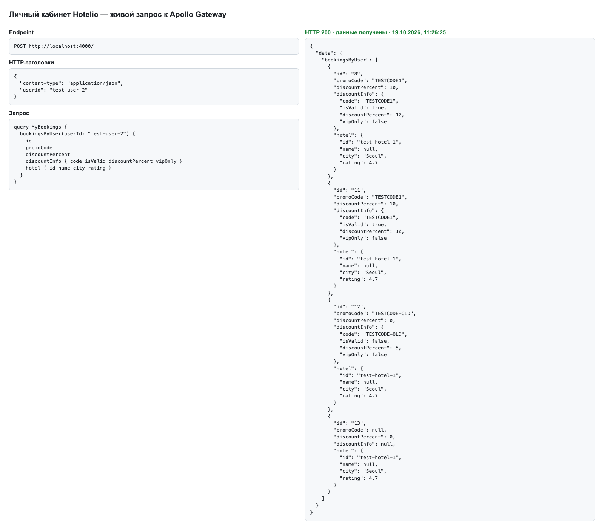
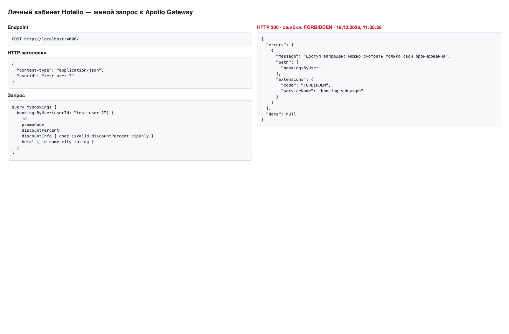

# Задание 3. Личный кабинет на GraphQL Federation

Личный кабинет — BFF на Apollo Federation 2 ([ADR-001](../../task1/results/ADR-001-strangler-booking.md), use case 4). Шлюз собирает суперграф из трёх подграфов, каждый подграф берёт данные у владельца своего домена.

| Модуль | Порт в сети | Источник данных | Что делает |
| :- | :- | :- | :- |
| `gateway` (apollo-gateway) | 4000 | — | Собирает суперграф (`IntrospectAndCompose`), передаёт подграфам `userid` и `x-request-id`, ограничивает глубину запроса и число псевдонимов |
| `booking-subgraph` | 4001 | booking-service по gRPC (`ListBookings`, контракт `task2/booking.proto`) | `bookingsByUser`, `userBookings`, `booking(id)`; ACL «только свои бронирования»; ссылка `Booking.hotel` |
| `hotel-subgraph` | 4002 | REST монолита `GET /api/hotels/{id}` | Сущность `Hotel`, `hotelsByIds`, DataLoader и кеш |
| `promocode-subgraph` | 4003 | REST монолита `/api/promos/...` | Поле `Booking.discountPercent` (`@override`), `Booking.discountInfo`, `validatePromoCode` |

Снаружи доступен только шлюз на порту 4000, подграфы работают во внутренней сети `hotelio-net`.

Версии: Node.js 22, `@apollo/server` 5, `@apollo/gateway` 2.14, `@apollo/subgraph` 2.15, `graphql` 16. Шаблон задания был на Apollo Server 4, поддержка которого закончилась 26.01.2026; вместо устаревшего `serviceList` используется `IntrospectAndCompose`.

## Что сделано

**booking-subgraph.** Заглушки заменены вызовом booking-service по gRPC. Схема в формате Federation 2 (`@link`): у `Booking` есть `id`, `userId`, `hotelId`, `promoCode`, `discountPercent`, `createdAt` и `hotel`. Отель — ссылка на сущность (`Hotel @key(fields: "id", resolvable: false)`), его поля отдаёт hotel-subgraph. Запрос из проверки задания называется `bookingsByUser`, из описания — `userBookings`; работают оба. Полей `checkIn`, `checkOut` и `status` из примера задания нет: монолит и booking-service их не хранят.

**ACL.** Резолверы booking-subgraph сравнивают `userid` из заголовка с запрошенным `userId`:
- нет заголовка или он пустой — `UNAUTHENTICATED`;
- чужие бронирования — `FORBIDDEN`, данные не возвращаются;
- `booking(id)` ищет только среди бронирований запросившего, чужое бронирование просто не находится.

Проверка стоит в подграфе — владельце данных. Каждое бронирование из ответа booking-service дополнительно сверяется с владельцем.

**Проброс заголовков.** Подсказка задания «все заголовки передаются из Gateway в подграфы автоматически» для `@apollo/gateway` неверна: шлюз передаёт заголовки клиента, только если их явно выставить в `RemoteGraphQLDataSource.willSendRequest` ([документация Apollo](https://www.apollographql.com/docs/apollo-server/using-federation/api/apollo-gateway)). С шлюзом из шаблона курса, где этого нет, даже владелец бронирований получает `UNAUTHENTICATED` — [negative-control-no-header-forwarding.txt](negative-control-no-header-forwarding.txt).

**hotel-subgraph и N+1.** `__resolveReference` и `hotelsByIds` загружают отели через DataLoader, который создаётся на каждый запрос: повторные id в пределах запроса склеиваются, данные разных запросов не смешиваются. Пачка — до 10 отелей, к монолиту одновременно уходит не больше четырёх запросов, поверх — общий кеш справочника на 30 секунд. Метода «отели по списку id» у монолита нет, а дорабатывать его по условию нельзя, поэтому пачка уходит в монолит параллельными запросами по одному id; один запрос на пачку появится вместе с сервисом отелей. [Запрос с четырьмя id, один из которых повторён](hotel-batching-and-course-query.txt), и [журнал hotel-subgraph по тому же x-request-id](hotel-subgraph-logs.txt) показывают одну пачку из трёх уникальных отелей и три обращения к монолиту.

**Название отеля.** У отеля в монолите нет названия и звёздности — это видно по классу в jar, исходникам, таблице и ответам API (ADR-001, Н3). Поля `name` и `stars` возвращают `null`, рядом отдаются реальные `city`, `rating` и `description`. Данные не выдумываем: поля заполнит будущий сервис отелей.

**promocode-subgraph и `@override`.** Новый подграф — первый шаг выделения промокодов. По схеме задания поле `Booking.discountPercent` переходит в него: `@override(from: "booking-subgraph") @requires(fields: "promoCode")`. Шлюз передаёт подграфу промокод бронирования, резолвер берёт скидку промокода из справочника монолита через DataLoader; без промокода — 0, промокода нет в справочнике — `null`. Что поле отдаёт именно новый подграф, видно в [журнале promocode-subgraph](promocode-subgraph-logs.txt) (`discountPercent resolved`).

После переноса поле означает скидку промокода по справочнику. Фактически применённая при бронировании скидка хранится в booking-service и уже учтена в цене бронирования; в To-Be сервис промокодов сам хранит факты применения. Резолвер в booking-subgraph остаётся: если снять `@override`, поле снова отдаёт сохранённое значение. Подграфы доступны только из сети шлюза, а клиентская схема шлюза не содержит `_entities`, поэтому промокод из представления сущности подграф принимает без повторной проверки.

Кроме того, `Booking.discountInfo` (`@requires(fields: "promoCode userId")`) возвращает `code`, `discountPercent`, `vipOnly`, `expired`, `validUntil`, `description` и `isValid` — действует ли промокод сейчас для этого пользователя с учётом VIP. Запрос `validatePromoCode(code, userId)` проверяет промокод отдельно. Запроса `activePromoCodes` нет: у монолита нет метода получить список промокодов.

**Отказы.** Поле `Booking.hotel` необязательное: если монолит не ответил по одному отелю, в `hotel` остаётся только `id`, остальные поля отеля равны `null`, а в `errors` появляется ошибка `HOTEL_UNAVAILABLE` с путём к этому `hotel`. Остальные бронирования и скидки в ответе сохраняются.

**Ограничения запросов.** Шлюз отклоняет запрос глубже 8 уровней и с числом псевдонимов больше 20 (правила [graphql-armor](https://github.com/Escape-Technologies/graphql-armor), с учётом фрагментов) — до обращения к подграфам. `hotelsByIds` принимает не больше 50 id. Служебные запросы шлюза к подграфам этими правилами не ограничены, поэтому длинный список бронирований с отелями и скидками читается целиком. Пакетная отправка нескольких операций в одном HTTP-запросе выключена (так по умолчанию в Apollo Server).

**Идентификатор запроса.** Шлюз принимает `x-request-id` клиента по тем же правилам, что booking-service (1–128 символов: латинские буквы, цифры и `-_.:`), иначе создаёт новый. Идентификатор возвращается в ответе, уходит в подграфы, в REST-запросы к монолиту и в gRPC-метаданные к booking-service; журналы всех сервисов пишут его в поле `requestId`.

## Как запустить и проверить

```bash
# нужен стенд задания 2 (монолит с прокси и booking-service) в сети hotelio-net
cd tasks/task3
docker compose up -d --build
./calls.sh success   # userid совпадает — бронирования с отелями и скидками
./calls.sh deny      # чужой userid — FORBIDDEN; без заголовка — UNAUTHENTICATED
./calls.sh course    # проверочный запрос задания: у user1 бронирований нет, пустой список
./calls.sh batch     # hotelsByIds с повторённым id

npm ci && npm test   # контрактные тесты: настоящие шлюз и подграфы, монолит и booking-service — заглушки
```

Скриншоты сняты со страницы [check.html](../check.html): при открытии она выполняет настоящий запрос к шлюзу на `localhost:4000` и показывает заголовки, запрос и ответ (`?mode=success` или `?mode=deny`).

## Результаты

| Требование задания | Файл |
| :- | :- |
| Report с описанием изменений | этот файл |
| Результат `docker ps` | [docker-ps.txt](docker-ps.txt) |
| Скриншот успешного вызова | [screenshot-success.png](screenshot-success.png) |
| Скриншот Deny по ACL | [screenshot-acl-deny.png](screenshot-acl-deny.png) |
| Логи booking-subgraph | [booking-subgraph-logs.txt](booking-subgraph-logs.txt) |
| Дополнительно | [promocode-subgraph-logs.txt](promocode-subgraph-logs.txt) — `discountPercent` отдаёт новый подграф; [negative-control-no-header-forwarding.txt](negative-control-no-header-forwarding.txt); [hotel-batching-and-course-query.txt](hotel-batching-and-course-query.txt) и [hotel-subgraph-logs.txt](hotel-subgraph-logs.txt) — батчинг отелей |





## Ограничения

- `userid` в заголовке — не аутентификация: его может подставить любой клиент. В To-Be шлюз проверяет токен входа и передаёт подграфам идентификатор из него, а заголовок клиента отбрасывает.
- Полный список бронирований пользователя читается одним запросом; для больших списков следующим шагом нужна пагинация.
- `@apollo/gateway` держит keep-alive-соединения: если пересоздать контейнер подграфа, шлюз обращается по старому адресу, пока его не перезапустить. В Kubernetes адреса сервисов стабильны.
- Для production Apollo рекомендует Apollo Router вместо шлюза на Node.js; по заданию оставлен `@apollo/gateway`, переход — в To-Be.
