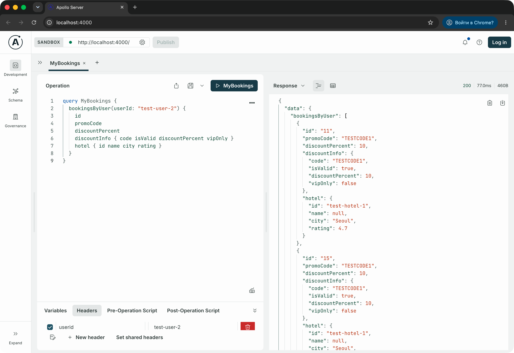
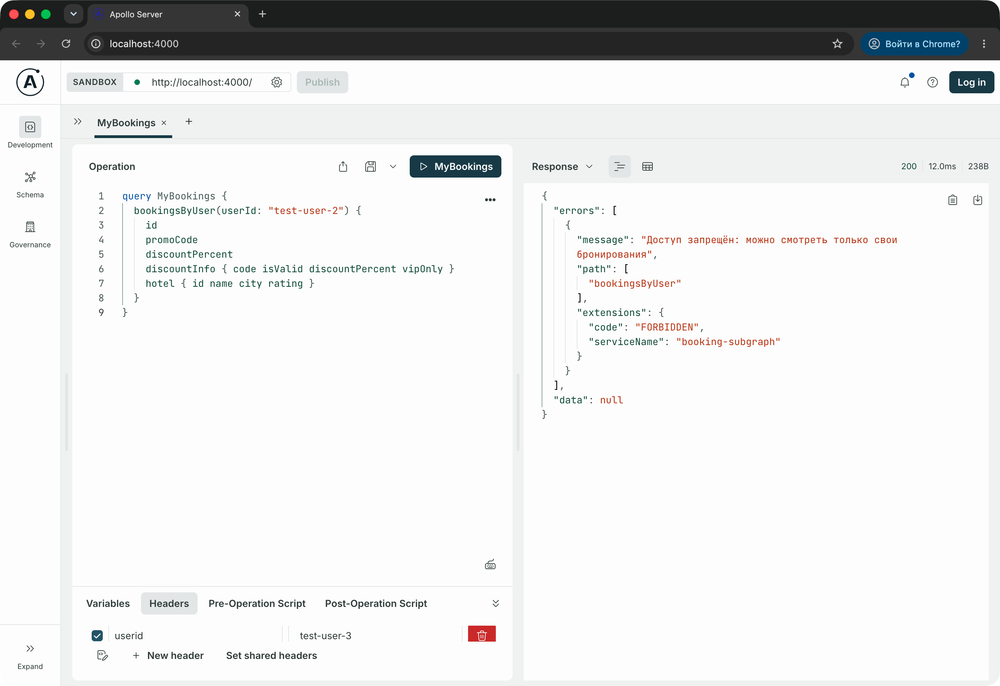

# Задание 3. Личный кабинет на GraphQL Federation

Личный кабинет — BFF на Apollo Federation 2 (сценарий 4 в [ADR-001](../../task1/results/ADR-001-strangler-booking.md)). Шлюз собирает суперграф из трёх подграфов, каждый подграф берёт данные у сервиса, который ими владеет.

| Модуль | Порт | Откуда данные | Что делает |
| :- | :- | :- | :- |
| `gateway` (apollo-gateway) | 4000 | — | Собирает суперграф и передаёт подграфам заголовки `userid` и `x-request-id` |
| `booking-subgraph` | 4001 | booking-service по gRPC (`ListBookings` из `task2/booking.proto`) | `bookingsByUser`, `userBookings`, `booking(id)`, ACL, ссылка на отель |
| `hotel-subgraph` | 4002 | REST монолита `GET /api/hotels/{id}` | Сущность `Hotel`, `hotelsByIds`, DataLoader и кеш |
| `promocode-subgraph` | 4003 | REST монолита `/api/promos/...` | `Booking.discountPercent` через `@override`, `Booking.discountInfo`, `validatePromoCode` |

Наружу открыт только шлюз, подграфы работают во внутренней сети `hotelio-net`. Версии: Node.js 22 в образах (тесты из `npm-test.txt` запускались на ноутбуке с Node.js 24), `@apollo/server` 5, `@apollo/gateway` 2.14, `@apollo/subgraph` 2.15. Apollo Server 4 из шаблона уже не поддерживается, поэтому обновлён до 5; устаревший `serviceList` в шлюзе заменён на `IntrospectAndCompose`.

## Что сделано

### booking-subgraph и ACL

Заглушки заменены вызовом booking-service по gRPC. У `Booking` есть поля из задания — `id`, `userId`, `hotelId`, `promoCode`, `discountPercent`, — а также `createdAt` и `hotel`. Отель — ссылка на сущность (`Hotel @key(fields: "id", resolvable: false)`), его поля отдаёт hotel-subgraph. В проверочном запросе задания запрос называется `bookingsByUser`, в примере схемы — `userBookings`; работают оба. Полей `checkIn`, `checkOut` и `status` из примера нет: ни монолит, ни booking-service их не хранят.

Резолверы сравнивают `userid` из заголовка с запрошенным `userId`:
- заголовка нет или он пустой — `UNAUTHENTICATED`;
- чужие бронирования — `FORBIDDEN`, данные не возвращаются;
- `booking(id)` ищет только среди бронирований самого пользователя, чужое бронирование просто не находится.

Проверка стоит в booking-subgraph, рядом с данными, а не в шлюзе.

### Заголовки `userid` и `x-request-id`

Сам `@apollo/gateway` заголовки клиента в подграфы не передаёт: без проброса даже свои бронирования возвращают `UNAUTHENTICATED` — это проверяет один из тестов ([npm-test.txt](npm-test.txt)). Поэтому шлюз выставляет `userid` и `x-request-id` в `RemoteGraphQLDataSource.willSendRequest` ([документация Apollo](https://www.apollographql.com/docs/apollo-server/using-federation/api/apollo-gateway)). Через подграфы `x-request-id` доходит до монолита и booking-service, так что один запрос можно найти в логах шлюза, подграфов и booking-service (поле `requestId`).

### Отели и N+1

`__resolveReference` и `hotelsByIds` загружают отели через DataLoader, который создаётся на каждый запрос: одинаковые id в пределах запроса склеиваются, а данные разных пользователей не смешиваются. Поверх него — общий кеш справочника отелей на 30 секунд (`lru-cache`, до 500 отелей). Метода «отели по списку id» у монолита нет, а дорабатывать монолит на этом этапе не планируем. Поэтому пачка уходит в монолит параллельными запросами по одному id, не больше четырёх одновременно (`p-limit`), чтобы длинный список не нагружал монолит; один запрос на пачку станет возможен с отдельным сервисом отелей. [Запрос с четырьмя id, один из которых повторён](hotel-batching-and-course-query.txt), и [лог hotel-subgraph](hotel-subgraph-logs.txt) показывают одну пачку из трёх уникальных отелей: все три запрошены у монолита.

У отеля в монолите нет названия и звёздности — ни в классе `Hotel`, ни в таблице, ни в ответах API. Поэтому `name` и `stars` возвращают `null`, а рядом отдаются `city`, `rating` и `description`. Название появится вместе с сервисом отелей.

### Промокоды и `@override`

Новый подграф — первый шаг выделения промокодов. Как в схеме задания, поле `Booking.discountPercent` переходит в него: `@override(from: "booking-subgraph")`. Чтобы посчитать скидку, подграфу нужен промокод бронирования, поэтому у поля стоит ещё `@requires(fields: "promoCode")`: шлюз передаёт промокод из booking-subgraph, резолвер берёт скидку из справочника монолита. Без промокода — 0, промокода нет в справочнике — `null`, поэтому тип поля `Float`, а не `Float!` из примера. То, что поле отдаёт именно новый подграф, видно в [логе promocode-subgraph](promocode-subgraph-logs.txt) (`discountPercent resolved`).

После переноса поле означает скидку промокода по справочнику. Фактически применённая скидка уже учтена в цене бронирования в booking-service; в To-Be сервис промокодов сам хранит, какая скидка применена к какому бронированию. Резолвер в booking-subgraph остался: если снять `@override`, поле снова отдаёт сохранённое значение.

`Booking.discountInfo` (`@requires(fields: "promoCode userId")`) показывает, действует ли промокод сейчас для этого пользователя с учётом VIP. Запрос `validatePromoCode(code, userId)` проверяет промокод отдельно и только для самого пользователя: ответ раскрывает VIP-статус, поэтому чужой `userId` даёт `FORBIDDEN`. Запроса `activePromoCodes` нет: у монолита нет метода, который отдаёт список промокодов.

### Отказы и лимиты

Поле `Booking.hotel` необязательное: если монолит не ответил по одному отелю, в `hotel` остаётся только `id`, а в `errors` появляется `HOTEL_UNAVAILABLE` с путём к этому полю. Остальные бронирования и скидки в ответе сохраняются. Так же отказ справочника промокодов даёт `PROMO_UNAVAILABLE` на полях скидки, а отказ booking-service — `BOOKING_UNAVAILABLE`; подробности ошибок gRPC и HTTP с внутренними адресами остаются в логах подграфов и клиенту не уходят.

Шлюз отклоняет слишком глубокие запросы и запросы с большим числом алиасов ([graphql-armor](https://github.com/Escape-Technologies/graphql-armor)), `hotelsByIds` принимает не больше 50 id.

## Как запустить и проверить

```bash
# нужен стенд задания 2 (монолит с прокси и booking-service) в сети hotelio-net
cd tasks/task3
docker compose up -d --build
./calls.sh success   # userid совпадает — бронирования с отелями и скидками
./calls.sh deny      # чужой userid — FORBIDDEN; без заголовка — UNAUTHENTICATED
./calls.sh course    # проверочный запрос задания: у user1 бронирований нет, пустой список
./calls.sh batch     # hotelsByIds с повторённым id

npm ci && npm test   # интеграционные тесты: настоящие шлюз и подграфы по HTTP, монолит и booking-service — заглушки
```

Проверочный запрос задания можно выполнить и в Playground (песочница Apollo) на http://localhost:4000/, заголовок `userid` задаётся во вкладке Headers. Песочница и introspection на шлюзе включены явно, потому что образ работает в production-режиме. Скриншоты ниже сняты там же: запрос своих бронирований с `userid: test-user-2` и тот же запрос с чужим `userid: test-user-3`.

## Результаты

| Требование задания | Файл |
| :- | :- |
| Report с описанием изменений | этот файл |
| Результат `docker ps` | [docker-ps.txt](docker-ps.txt) |
| Скриншот успешного вызова | [screenshot-success.png](screenshot-success.png) |
| Скриншот Deny по ACL | [screenshot-acl-deny.png](screenshot-acl-deny.png) |
| Логи booking-subgraph | [booking-subgraph-logs.txt](booking-subgraph-logs.txt) |
| Дополнительно | [promocode-subgraph-logs.txt](promocode-subgraph-logs.txt) — `discountPercent` отдаёт новый подграф; [hotel-batching-and-course-query.txt](hotel-batching-and-course-query.txt) и [hotel-subgraph-logs.txt](hotel-subgraph-logs.txt) — загрузка отелей пачками; [npm-test.txt](npm-test.txt) — 17 тестов шлюза, подграфов и кеша отелей |





## Ограничения

- Заголовок `userid` может подставить кто угодно. Перед тем как открыть кабинет наружу, шлюз должен проверять JWT и сам передавать подграфам id пользователя из токена (риск Р8 в ADR-001).
- Список бронирований пользователя читается целиком; для больших списков следующим шагом нужна пагинация.
- Для production Apollo рекомендует Apollo Router вместо шлюза на Node.js; по заданию оставлен `@apollo/gateway`.
