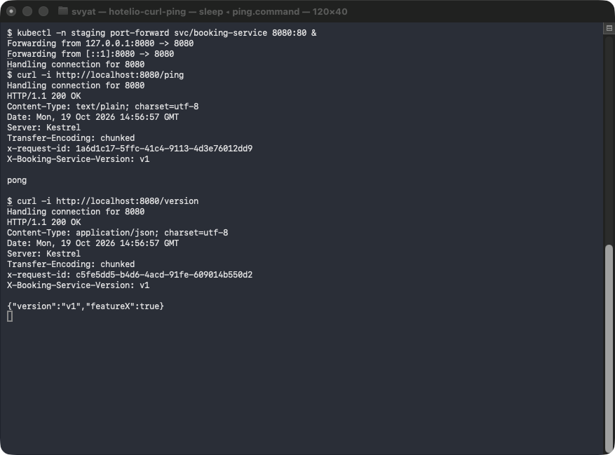
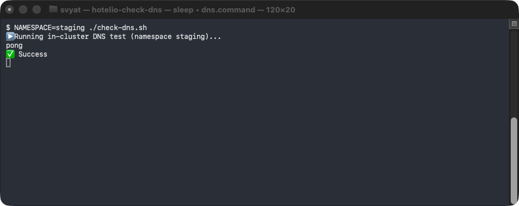
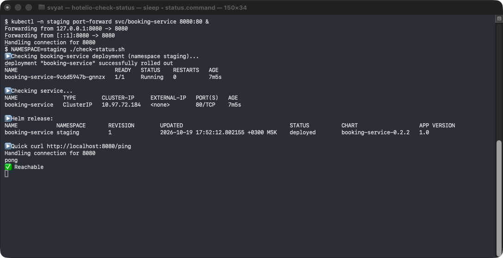

# Задание 4. Автоматизация развёртывания и тестирования

Вместо Go-заготовки разворачивается настоящий booking-service (C#, .NET 10) из задания 2. Образ собирается тем же Dockerfile, что и в задании 2: [`tasks/task2/booking-service/Dockerfile`](../../task2/booking-service/Dockerfile), контекст сборки — `tasks/task2`.

## Развёртывание

```bash
minikube start --driver=docker --cpus=4 --memory=8192
cd tasks/task4
gitlab-ci-local build unit-tests test deploy tag   # пайплайн: сборка, тесты, staging, git-тег
gitlab-ci-local deploy-prod                         # тот же образ в namespace prod с values-prod.yaml
gitlab-ci-local rollback-prod                       # откат prod на предыдущую ревизию Helm

# то же вручную
TAG=$(git rev-parse --short=8 HEAD)
docker build -f ../task2/booking-service/Dockerfile -t booking-service:$TAG ../task2
minikube image load booking-service:$TAG
helm upgrade --install booking-service helm/booking-service -n staging --create-namespace \
  -f helm/booking-service/values-staging.yaml --set image.tag=$TAG --wait
```

Проверка:

```bash
NAMESPACE=staging ./check-dns.sh                      # http://booking-service/ping изнутри кластера
kubectl -n staging port-forward svc/booking-service 8080:80 &
NAMESPACE=staging ./check-status.sh                   # под, Service, релиз Helm и curl /ping через port-forward
```

Окружение: macOS (Apple Silicon), Colima с Docker 29, Minikube 1.39 (Kubernetes 1.37), Helm 4.3, gitlab-ci-local 4.76.

## Docker-образ

Сборка в два этапа (SDK → runtime), базовые образы закреплены по digest, процесс работает не от root.

| Требование | Как сделано |
| :- | :- |
| Сборка `docker build` | `docker build -f booking-service/Dockerfile -t booking-service:<tag> .` в `tasks/task2` |
| Порт 8080, `/ping` → `pong` | Служебный HTTP на 8080; gRPC для прокси монолита — на 9090 |
| Поведение при `ENABLE_FEATURE_X=true` | Открывается `GET /feature`, `/version` показывает `featureX: true` |

В кластере заданий 4–5 нет БД, Kafka и монолита: под отвечает на `/ping`, `/version` и `/feature`, а бизнес-путь бронирования проверяется на стенде задания 2. Адреса зависимостей сервис требует при старте, поэтому чарт передаёт их явно, а публикацию событий выключает (`OUTBOX_PUBLISHER=disabled`). `/ready` проверяет БД и здесь отвечает 503, поэтому обе пробы смотрят на `/ping`, как и требует задание; в окружении с БД readiness переводится на `/ready`.

## Helm-чарт

[`helm/booking-service`](../helm/booking-service):
- Deployment с `livenessProbe` и `readinessProbe` по `/ping`, Service типа ClusterIP: порт 80 → 8080;
- в `values.yaml` — `replicaCount`, `image.name/tag/pullPolicy`, `env[]`, `resources`, `featureFlags.enableFeatureX` (→ `ENABLE_FEATURE_X`), адреса зависимостей;
- тег образа обязателен: без него рендер чарта завершается ошибкой, и плавающий `latest` в релиз не попадает;
- `imagePullPolicy` задаётся в values, а не в шаблоне;
- для окружения с БД: `migrations.enabled=true` запускает Job с командой `migrate` из того же образа перед установкой и обновлением, строка подключения — из Secret (`dependencies.existingSecret`).

| Параметр | [staging](values-staging.yaml) | [prod](values-prod.yaml) |
| :- | :- | :- |
| Реплики | 1 | 3 |
| `ENABLE_FEATURE_X` | true — проверяем новую функцию | false |
| Ресурсы requests / limits | 100m, 128Mi / 500m, 256Mi | 250m, 256Mi / 1, 512Mi |
| `imagePullPolicy` | Never — образ загружен в Minikube | IfNotPresent — образ из registry по неизменяемому тегу |

## CI/CD

[`.gitlab-ci.yml`](.gitlab-ci.yml):

| Стадия | Задание | Что делает |
| :- | :- | :- |
| build | `build` | `docker build` с тегом — коротким SHA коммита |
| test | `unit-tests` | Тесты сервиса (`dotnet test`) в контейнере .NET SDK |
| test | `test` | `docker run`: `/ping` → `pong`, `/feature` при `ENABLE_FEATURE_X=true`, `/ready` без БД → 503 |
| deploy | `deploy` | `minikube image load`, `helm upgrade --install` в namespace staging, проверка DNS |
| tag | `tag` | Аннотированный git-тег `booking-service-<дата-время>`; отправка в origin — при `PUSH_TAG=true` |
| release | `deploy-prod`, `rollback-prod` | Вручную: тот же образ в prod без пересборки, `check-promotion.sh` сверяет imageID подов staging и prod; откат — `helm rollback` |

Чтобы было что откатывать, вторая ревизия prod включает фича-флаг (`helm upgrade --reuse-values --set featureFlags.enableFeatureX=true`); `rollback-prod` возвращает ревизию 1 — флаг снова выключен, образ тот же ([helm-rollback.log](helm-rollback.log)).

Registry нет, поэтому образ попадает в Minikube через `minikube image load`. Для внешнего кластера здесь будут публикация образа в registry и доступ к нему из кластера.

## Service discovery через DNS

`check-dns.sh` из шаблона запускал `kubectl run --rm -it` без терминала: под завершался раньше, чем kubectl подключался к выводу, ответ печатался дважды (`pongpong`), и проверка падала. Теперь скрипт запускает под с `curl` без sidecar, ждёт его завершения, читает журнал и сравнивает ответ с `pong`. Недоступный сервис даёт ненулевой код выхода.

## Результаты

| Что | Файл |
| :- | :- |
| Пайплайн build → test → deploy → tag | [pipeline-build-log.txt](pipeline-build-log.txt) |
| Продвижение того же образа в prod и откат | [prod-promotion.log](prod-promotion.log), [helm-rollback.log](helm-rollback.log) |
| `curl /ping` через port-forward | [скриншот](screenshot-curl-ping.png), [текст](curl-ping.txt) |
| `./check-dns.sh` | [скриншот](screenshot-check-dns.png), [текст](check-dns.txt) |
| `./check-status.sh` | [скриншот](screenshot-check-status.png), [текст](check-status.txt) |
| `kubectl get pods,services` | [kubectl-get-pods-services.txt](kubectl-get-pods-services.txt) |
| `docker image ls` и `minikube image list` | [docker-image-ls-and-minikube-image-list.txt](docker-image-ls-and-minikube-image-list.txt) |
| values для staging и prod, `.gitlab-ci.yml` | [values-staging.yaml](values-staging.yaml), [values-prod.yaml](values-prod.yaml), [.gitlab-ci.yml](.gitlab-ci.yml) |






